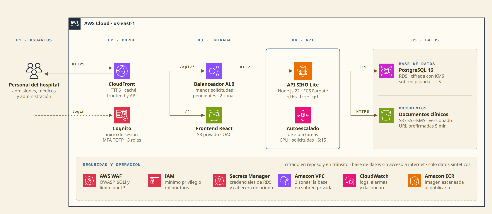
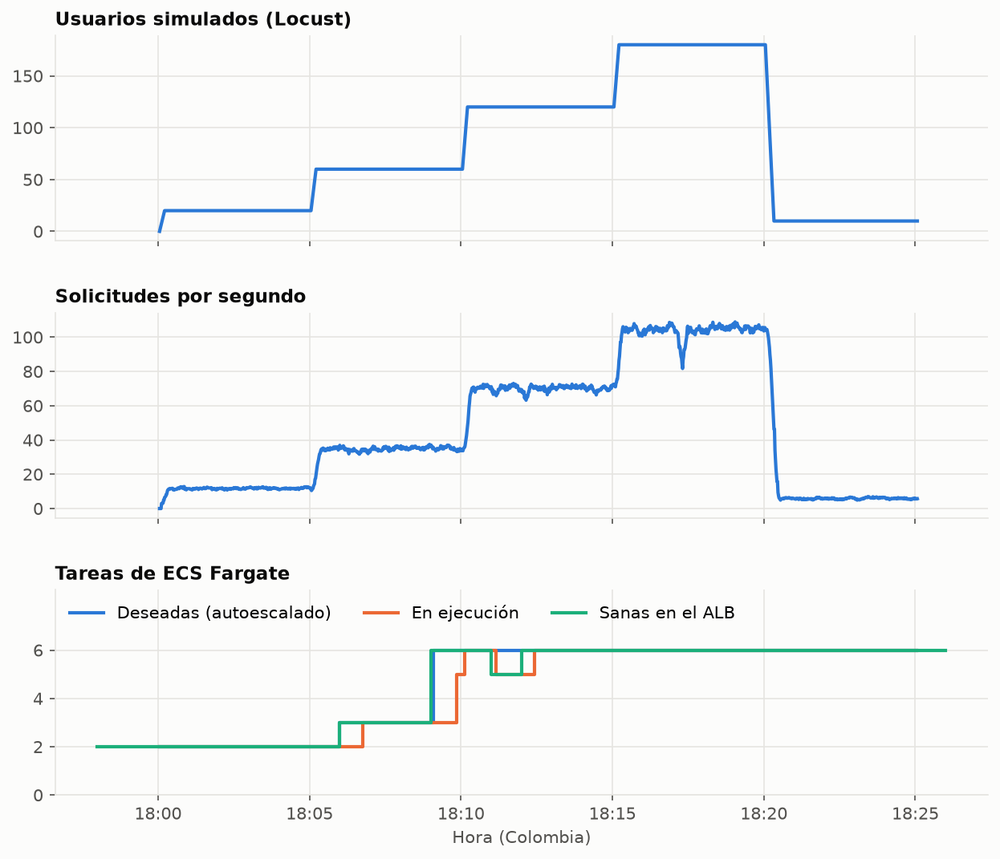

# SIHO Lite

Prototipo del módulo de admisiones, agenda de citas y documentos clínicos del SIHO (E.S.E. Hospital Regional del Fonce, caso académico), desplegado en AWS con ECS Fargate, ALB, RDS PostgreSQL, S3, CloudFront, Cognito y WAF. **Solo datos sintéticos.**

El diseño completo está en [`CLAUDE.md`](CLAUDE.md) y la bitácora en [`docs/bitacora.md`](docs/bitacora.md).

## Arquitectura



1. **Usuarios.** El personal del hospital entra desde el navegador por HTTPS e inicia sesión con Amazon Cognito (MFA TOTP obligatoria y grupos `admin`, `admisiones` y `medico`).
2. **Borde.** Amazon CloudFront, protegido por AWS WAF, sirve el frontend y reenvía `/api/*` al balanceador con una cabecera secreta. El balanceador solo acepta tráfico de CloudFront.
3. **Entrada.** El Application Load Balancer envía cada solicitud a la tarea con menos solicitudes pendientes. El frontend en React vive en un bucket S3 privado (OAC).
4. **API.** Node.js 22 en ECS Fargate, de 2 a 6 tareas en dos zonas de disponibilidad. Application Auto Scaling escala por CPU (60 %), por solicitudes por tarea (300 por minuto) y con una acción programada para el pico de las 6:15 a. m.
5. **Datos.** RDS PostgreSQL 16 cifrada, en subred privada y con TLS obligatorio; documentos clínicos en S3 con SSE-KMS, subidos y descargados con URL prefirmadas.

Versión editable: [`docs/arquitectura/arquitectura.svg`](docs/arquitectura/arquitectura.svg). Versión autónoma, con los íconos incrustados, para Word o PowerPoint: [`arquitectura-autonomo.svg`](docs/arquitectura/arquitectura-autonomo.svg).

## Resultados de la prueba de carga

Escalones de 20 a 180 usuarios simultáneos: **68.413 solicitudes, 0 fallidas**, p95 de 140 ms visto por el usuario (16 a 44 ms en el servidor). El servicio escaló solo de 2 a 6 tareas y repartió la carga de forma pareja (coeficiente de variación de 0,7 % entre tareas). Detalle en [`docs/resultados/escalones/resumen.md`](docs/resultados/escalones/resumen.md).



## Correr en local

Requisitos: Docker con Compose, Node.js 22 o superior.

```bash
cp .env.example .env            # y cambia los valores
docker compose up -d --build    # PostgreSQL + almacenamiento S3 local + migraciones + seed + API (puerto 3000)
cd web && npm install && npm run dev   # frontend en http://localhost:5173
```

En local el login es de desarrollo: eliges el rol (`admisiones`, `medico`, `admin`).

### Pruebas

```bash
cd api && npm install && npm test        # requiere `docker compose up -d db`
uv venv .venv && uv pip install --python .venv/bin/python playwright locust boto3 matplotlib pandas
.venv/bin/playwright install chromium
.venv/bin/python scripts/capturas_app.py --base http://localhost:5173 --salida docs/capturas/local
```

## Desplegar en AWS

Requisitos: AWS CLI 2, Terraform 1.9 o superior, Docker. Todo usa el perfil dedicado `siho`
(`scripts/entorno_aws.sh` se niega a trabajar si el perfil apunta a otra cuenta).

```bash
aws login --profile siho --region us-east-1
scripts/presupuesto.sh tu-correo@ejemplo.com          # AWS Budgets USD 20 ANTES de crear recursos

# infra/terraform.tfvars (no versionado):
#   correo_alertas   = "tu-correo@ejemplo.com"
#   ips_prueba_carga = ["TU.IP.PUBLICA/32"]          # se excluye del límite de tasa del WAF

cd infra && terraform init
terraform apply -target=aws_ecr_repository.api -target=aws_ecr_lifecycle_policy.api -var image_tag=pendiente
cd .. && TAG=$(scripts/deploy.sh imagen)               # construye y publica la imagen en ECR
cd infra && terraform plan -var image_tag=$TAG -out plan.tfplan && terraform apply plan.tfplan
cd .. && scripts/deploy.sh migrar                      # migraciones + seed como tarea única de ECS
scripts/deploy.sh web                                  # frontend a S3 + invalidación de CloudFront
.venv/bin/python loadtest/cognito.py crear             # usuarios de prueba con MFA
```

Despliegues posteriores de la API sin cortes: `scripts/deploy.sh api`.

## Prueba de carga

```bash
URL=$(terraform -chdir=infra output -raw url_app)
ESCENARIO=escalones .venv/bin/locust -f loadtest/locustfile.py --host $URL --headless --csv-full-history \
  --csv docs/resultados/escalones/locust --html docs/resultados/escalones/locust.html
.venv/bin/python loadtest/analizar.py docs/resultados/escalones
```

Escenarios: `base` (20 usuarios, 10 min), `escalones` (20, 60, 120 y 180 usuarios, 5 min cada uno), `rafaga` (de 10 a 200 en 30 s).

## Destruir (al terminar, cada día encendido cuesta unos USD 2,5)

```bash
cd infra && terraform destroy -var image_tag=destruir
```

El presupuesto de AWS Budgets se deja activo a propósito.
